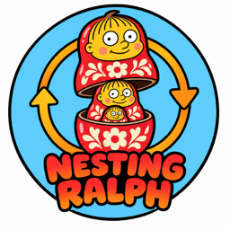
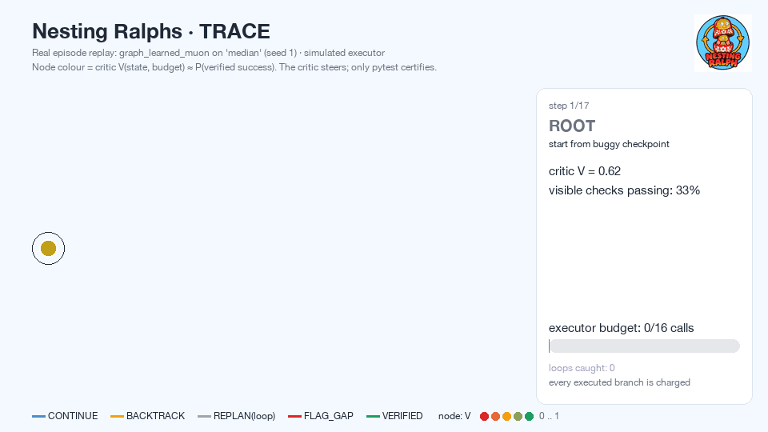

<p align="center"></p>

<h1 align="center"> Nesting Ralphs</h1>

**A loss function for agent traces based on Ralph Wiggum and Russian Nesting Dolls principles.**

Ralph: keep trying the same loop until checks pass. Nesting dolls: every loop is a doll with its own definition of done and budget; a learned critic picks which doll to open next. The critic steers; it never certifies.

Live site: https://nesting-ralphs.vercel.app

A Ralph-style executor proposes and executes steps. A controller keeps checkpoints, compares
branches and reallocates attempts. A small critic `V(state, budget) ≈ P(verified success within budget)`
is trained on real rollout outcomes. An independent pytest verifier on a frozen contract decides success.
TRACE (`runs/trace.html`) replays the search history.

> Status: small-scale mechanism check. **The executor in the reported run is a seeded simulated policy, not an LLM.**
> All numbers below are copied from `runs/results.json`, which `uv run python -m trace_critic.run` regenerates
> deterministically (≈6 s on a laptop).

<p align="center"></p>

<sub>Replay of a real logged episode (`graph_learned_muon` on the sealed `median` task, simulated executor):
the critic backtracks, a visibly-passing branch is flagged by the verifier (`FLAG_GAP`), repeats are dropped,
and the run ends only when the independent pytest verifier passes. Regenerate: `uv run python scripts/make_gif.py`.</sub>

## Quick start

```bash
uv sync
uv run python -m trace_critic.run            # simulated executor (default)
open runs/trace.html
```

Optional, with an OpenAI-compatible Nemotron endpoint:

```bash
export CRUSOE_INFERENCE_BASE_URL=... CRUSOE_INFERENCE_API_KEY=... CRUSOE_INFERENCE_MODEL=...
uv run python -m trace_critic.run --executor nemotron
```

## What is implemented

| Piece | File | Notes |
|---|---|---|
| 8 buggy fixture tasks, task-family split | `tasks.py` | train: 4 · valid: 1 (epoch/feature selection only) · test: 3 (sealed) |
| Frozen contract + verifier | `env.py` | `criterion_id → pytest::test_*`, SHA-256 of the tests checked on every call; tests live outside the executor workspace; executor sees only *visible* checks, verifier runs all (incl. hidden) |
| Executors | `executor.py` | `SimulatedExecutor` (seeded: follows failing checks, makes wrong edits, repeats itself); `NemotronExecutor` (OpenAI-compatible chat API) |
| Rollout labels | `run.py:collect` | states at action boundaries from 25 source trajectories/task; `K=6` continuations with budget `B ∈ {4, 8, 16}`; label `q = successes / valid_rollouts`, numerator and denominator stored |
| Critic | `critic.py` | MLP, `L = mean (V − q)²`; ablation **AdamW** vs **Muon (Newton–Schulz, hidden 2-D matrix) + AdamW** |
| Controllers | `search.py` | bounded Ralph · graph best-first with fixed rules · same graph search with learned critic; `K=2`, shared budget ledger, every executed branch charged |
| Decisions | `search.py` | `CONTINUE`, `BACKTRACK`, `REPLAN(loop)`, `FLAG_GAP` (verifier failed on a visibly-passing state), `VERIFIED`, `STOP_UNRESOLVED` |
| TRACE | `report.py`, `runs/traces/*.jsonl` | static HTML replay + export to HF Session Trace Simple Format |

Features are environment-only: visible-check status, deltas, repeats, budget, edit stats.
They exclude the task id, the narration, hidden checks and the outcome.

## Results (simulated executor, sealed test tasks, 180 episodes/controller, budget 16 executor calls)

| Controller | Verified success | 95% CI (Wilson) | Calls / verified success | Verify-fail rate |
|---|---|---|---|---|
| Bounded Ralph | 0.767 | [0.700, 0.822] | 12.35 | 0.622 |
| Graph + rules | 0.761 | [0.694, 0.818] | 12.80 | 0.372 |
| Graph + learned critic (AdamW) | 0.622 | [0.550, 0.690] | 16.32 | 0.429 |
| Graph + learned critic (Muon+AdamW) | 0.628 | [0.555, 0.695] | 16.34 | 0.423 |

Critic quality on 563 held-out test states:

| Model | MSE | Pairwise rank acc. |
|---|---|---|
| Critic, AdamW | 0.0714 | 0.550 |
| Critic, Muon+AdamW | 0.0718 | 0.563 |
| Reference: visible pass fraction | 0.1368 | 0.435 |
| Reference: constant train mean | 0.1178 | — |

### Honest reading

- **The hypothesis is not supported by this run.** At equal budget the learned controller verified *fewer* tasks than
  bounded Ralph or the rule-based graph search. Better state-value MSE did not translate into better branch selection.
- The critic generalizes to unseen task families better than the non-learned references. Its pairwise ranking is
  only slightly above chance, though, and ranking is what the controller needs.
- Graph search (rules or learned) roughly halves wasted verifications (verify-fail rate 0.37–0.43 vs 0.62).
- Muon vs AdamW: no measurable difference for this tiny head.
- Two fixes were made **before** reading test numbers again, and both are recorded in the code:
  1. Graph search used to drop expanded checkpoints, so it ran out of frontier at ≈7/16 calls.
     Checkpoints can now be re-expanded, with a priority penalty.
  2. Hashed source tokens acted as a task-identity proxy and destroyed generalization. The feature set
     (full vs structural) is now chosen on the **valid** family only (`feature_selection_valid_mse` in results).
- Likely next steps: a pairwise/ranking loss between sibling branches, labels from the *same* controller that
  consumes them (labels here come from Ralph continuations, i.e. a different policy), and a real LLM executor.

## Nemotron / Crusoe

The provided Crusoe Cloud credentials authenticate against the Cloud API (`GET /v1alpha5/organizations/projects` → 200).
No inference endpoint or Nemotron model ID was verified within the time box, so the reported run uses the simulated executor.
Credentials go in `.env`, which is gitignored and never committed.

## Not claimed

No novelty claims. This is a simulation. Value/process critics from Monte Carlo outcomes are prior work (e.g. AgentPRM).
Names and ideas borrowed from the "Matryoshka Ralph" spec (`FLAG_GAP`, "the loss steers, it never certifies") are
design choices; none of that spec's figures are reported here.

## License

MIT
